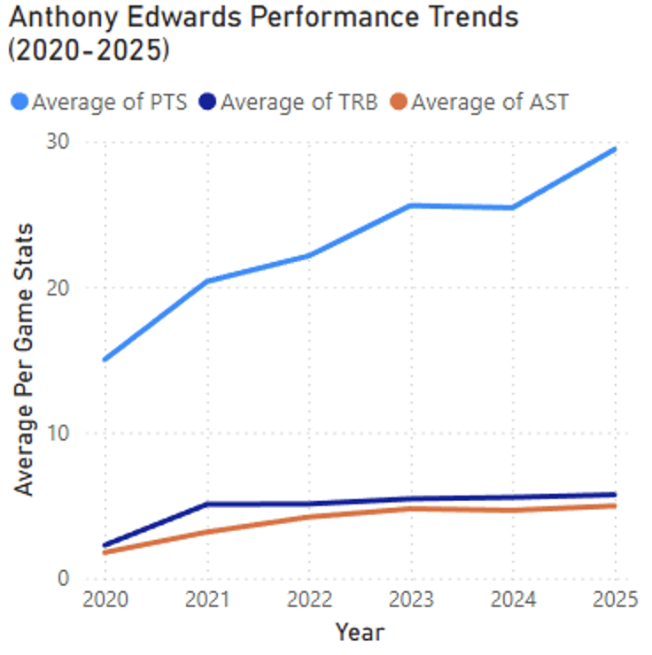
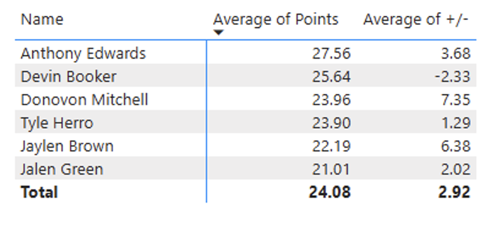
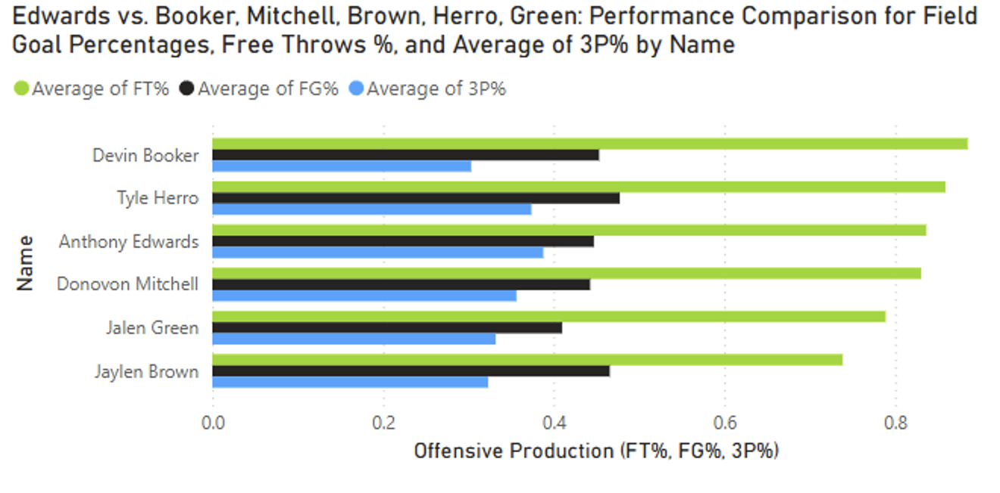

# Anthony Edwards Power BI Performance Dashboard

Collaborative Power BI case study by **Vansh Verma and Denny Hoang**.

Two interactive report pages explore Edwards' development, win/loss scoring
patterns and a selected group of five peer guards. This repository presents
reviewed screenshots, documented findings and technical evidence extracted from
the original final submission, without distributing its embedded sports data.

## At a glance

- **Coverage:** five NBA seasons, 2020-21 through 2024-25; peer comparison for 2024-25.
- **Report:** two 1280 x 720 pages and 20 visual containers, including five slicers.
- **Model diagram:** 18 named tables; relationship/cardinality semantics remain unverified.
- **Tools used in the original project:** Power BI, Power Query, Excel, report modeling, implicit aggregations, interactive filtering and analytical storytelling.
- **New portfolio audit tooling:** Python ZIP/JSON inspection and workbook validation, added in November 2026 and kept distinct from the 2025 team project.

## Review the proof

| Evidence | What a reader can verify |
| --- | --- |
| [Technical evidence](technical/TECHNICAL_EVIDENCE.md) | Report pages, table inventory, field bindings and evidence boundaries |
| [Report inventory](technical/report_inventory.json) | Machine-readable layout/visual/query metadata derived from the PBIX |
| [Source inventory](technical/source_inventory.json) | Original file sizes, SHA-256 fingerprints and submission reconciliation |
| [Data validation](technical/data_validation.json) | Aggregate checks recalculated from the original private workbooks |
| [Methods and limitations](METHODS_AND_LIMITATIONS.md) | Definitions, interpretation corrections and remaining verification work |

## Analytical questions

1. How did Edwards' scoring, rebounds, assists and shooting percentages change?
2. How did average scoring differ between recorded wins and losses?
3. How did his 2024-25 production compare with Devin Booker, Donovan Mitchell, Tyler Herro, Jaylen Brown and Jalen Green?
4. What patterns appear when filtering opponent, home/away context, player and game result?

## Workflow

1. Assembled player and team game logs identified in the final report as primarily from Basketball-Reference, with NBA.com used for team context.
2. Prepared three Excel workbooks containing five Edwards season sheets, five team season sheets and five peer-player sheets.
3. Consolidated the analysis in Power BI; the model diagram names 15 source-oriented tables and three consolidated analysis tables.
4. Created interactive report pages with date, opponent, home/away, player and result slicers.
5. Recalculated the featured aggregates from the private source workbooks and inspected the report's serialized visual queries.

## Dashboard evidence

### Calendar-year production trend



The original chart uses the **calendar-date Year hierarchy**, not an explicit NBA
season axis. Separately, the source workbooks show Edwards' NBA-season scoring
average increasing from **19.33 in 2020-21** to **27.56 in 2024-25**. Those season
averages should not be substituted for the chart's calendar-year values.
Rebounds and assists did not rise in every season.

### Selected-peer scoring comparison for 2024-25



Edwards recorded **27.56 points per recorded game**, the highest average in this
six-player comparison set. This is a selected-peer comparison, not a league-wide
ranking. Plus/minus is contextual, not an individual causal-impact measure.

### Shooting-percentage comparison



The original visual averages game-level shooting percentages. That differs from
an attempt-weighted percentage calculated from season makes and attempts.
Scoring volume and shooting efficiency answer different questions.

## Additional checked finding

Across **381 games with numeric Edwards point totals**, the source workbooks
produce **24.83 points in 204 wins** and **22.77 in 177 losses**. This is an
association in the project snapshot, not evidence that scoring caused the result.
Nonappearances with missing point totals and summary rows are excluded.

## Contribution and attribution

Vansh Verma and Denny Hoang worked jointly across source collection and
preparation, Power Query, report modeling, calculations, visual design,
documentation and presentation. The final report confirms joint authorship but
does not document a per-person task split. This project is collaborative work.
The radar chart is a bundled Microsoft custom visual; its implementation is not
claimed as team-authored code.

## Run the portfolio checks

The inspectors are **new November 2026 audit utilities**, not recovered Power
Query or DAX from the original report. Python 3 is required; workbook validation
also needs `openpyxl`.

```sh
python3 -m pip install -r requirements.txt
PYTHONDONTWRITEBYTECODE=1 python3 -m unittest discover -s tests -v
python3 scripts/inspect_pbix.py /path/to/authorized/Project.pbix --output report_inventory.json
python3 scripts/validate_workbooks.py /path/to/authorized/source_folder --output data_validation.json
```

No Power BI engine is launched, no source data is refreshed and no embedded code
is executed. The public tests use small synthetic fixtures. Original source files
are not provided by this repository.

## What remains unverified

- A fresh Power BI Desktop open, refresh and slicer-interaction run.
- Exact Power Query steps, explicit DAX definitions and model relationship/cardinality details.
- The assumptions and validation behind the original forecast.

The compressed model was not decoded by these checks. The original forecast and
win/loss donut remain outside the featured proof because their interpretation
requires additional care. See [methods](METHODS_AND_LIMITATIONS.md).

## Data and viewing boundary

This is a **non-commercial portfolio case study with screenshots and sanitized
technical evidence**. The original PBIX, workbooks, final write-up, proposal and
custom-visual code remain private. Readable source structure is evidence of the
original report; it is not a fully reproducible raw-data build.

Data providers: [Basketball-Reference](https://www.basketball-reference.com/)
and [NBA.com](https://www.nba.com/). See [data attribution and usage](DATA_AND_USAGE.md).
