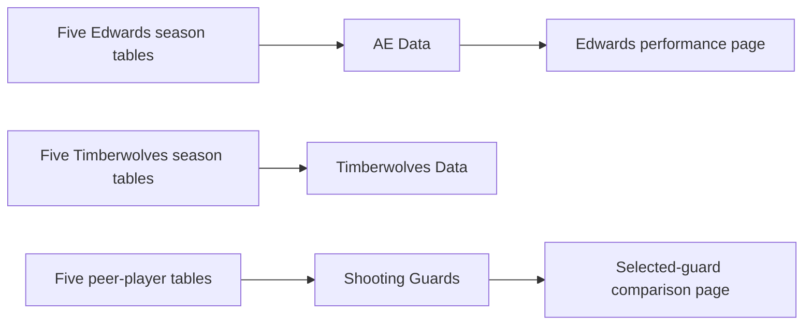

# Technical evidence from the final project

The original final submission was reopened and reconciled on November 8, 2026.
The final write-up and project archive contain the same six substantive artifacts
as the previously audited local originals. No new dashboard version was found.
The additions here expose more of that existing evidence for review.

## Original artifact inventory

The original package contains a PBIX report, three Excel workbooks, the joint
final write-up and the project proposal. The separately submitted write-up is
byte-identical to the copy inside the archive. File sizes and SHA-256 hashes are
recorded in [source_inventory.json](source_inventory.json).

The public inventory excludes private course-account identifiers, submission
links, grading material, personal metadata and local filesystem paths. Hashes
identify the inspected versions; a hash alone is not proof of report execution.

## Report and model organization

This diagram summarizes organization and visible report use, not recovered model
relationships or Power Query definitions. The 18 diagram table names comprise:

| Group | Original names |
| --- | --- |
| Edwards seasons | AE 2020-2021; AE 2021-2022; AE 2022-2023; AE 2023-2024; AE 2024-2025 |
| Team seasons | Timberwolves 2020-2021; Timberwolves 2021-2022; Timberwolves 2022-2023; Timberwolves 2023-2024; Timberwolves 2024-2025 |
| Five comparison players | Devin Booker; Donovon Mitchell 2024-2025; Jalen Green 2024-2025; Jaylen Brown 2024-2025; Tyler Herro 2024-2025 |
| Consolidated analysis tables | AE Data; Timberwolves Data; Shooting Guards |

The source table's `Donovon` spelling is preserved in the machine-readable
inventory; the narrative uses the player's correct spelling, Donovan Mitchell.

## Field and metric evidence

The [report inventory](report_inventory.json) records the actual serialized
visual bindings and selected query expressions. Visible fields include:

| Purpose | Source evidence |
| --- | --- |
| Time filtering and chart grouping | AE Data.Date and its calendar-date hierarchy |
| Matchup/context filters | AE Data.HomeAway; AE Data.Opp |
| Win/loss grouping | AE Data.WinFlag |
| Peer selection and game result | Shooting Guards.Name; Shooting Guards.Result.1 |
| Production metrics | PTS, TRB, AST, FT and 3P bindings |
| Context and efficiency | +/-, FG%, FT%, 3P%, TOV and PF bindings |

Query aliases are retained as aliases, not presented as trusted formulas. The
inventory also records actual aggregation operators/native labels where available.
That is implicit-query evidence, not recovered explicit DAX source.

## Additional checks

[Data validation](data_validation.json) records aggregate checks from the private
workbooks, including numeric-PTS appearance counts, season-level means, win/loss
means and selected-peer scoring. It publishes no game-level rows.

The [PBIX inspector](../scripts/inspect_pbix.py) and
[workbook validator](../scripts/validate_workbooks.py) are new November 2026
portfolio utilities. Their focused tests use synthetic inputs; the utilities do
not launch Power BI, execute bundled code or update the original files.

## Remaining proof to obtain

1. Open the original in Power BI Desktop and verify refresh and slicer behavior.
2. Inspect and export exact Power Query M, explicit DAX and model relationships.
3. Check calendar/season semantics and compare average percentages with weighted rates.
4. Document or remove the original forecast; avoid causal interpretations of group averages.

These items remain outstanding. The public evidence does not claim they were
completed or silently replace them with newly invented formulas.
